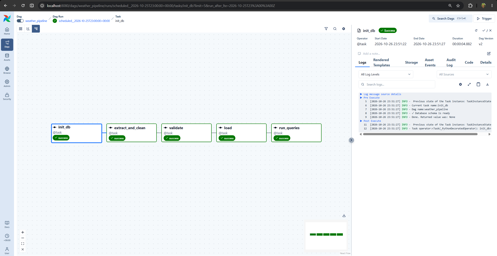

# Weather ETL Pipeline


An end-to-end data pipeline that collects daily weather data for Philippine
cities, validates and cleans it with Python and pandas, stores it in
PostgreSQL, and analyzes it with SQL. Orchestrated by Apache Airflow, which
runs it daily with automatic retries and failure alerts.

Built as a portfolio project to practice core data engineering skills:
**extract, transform, load, validate, test, orchestrate, and automate.**

## Architecture

```
                 Airflow DAG (daily, 07:00 Asia/Manila)
 ┌──────────────────────────────────────────────────────────────┐
 │                                                              │
 │  init_db → extract_and_clean → validate → load → run_queries │
 │                                    │                         │
 └────────────────────────────────────┼─────────────────────────┘
                                      │
   Open-Meteo API ──► pandas ──► validation ──► PostgreSQL
                                      │
                                      └──► weather_rejected.csv

   On final failure ──► PIPELINE ALERT in task log + data/pipeline_alerts.log
```


## Tech Stack

| Area | Tool |
|---|---|
| Language | Python 3.12 |
| Data handling | pandas, requests |
| Database | PostgreSQL 16 (psycopg2) |
| Orchestration | Apache Airflow 3.3 |
| Containers | Docker, docker-compose |
| Testing | pytest (17 tests) |
| CI | GitHub Actions with a PostgreSQL service container |

## Project Structure

```
weather-etl-pipeline/
├── src/
│   ├── db.py              # PostgreSQL connection helper
│   ├── fetch_weather.py   # fetch, clean, load
│   ├── validate.py        # data quality checks
│   ├── init_db.py         # schema setup
│   └── run_queries.py     # run all SQL queries
├── airflow/
│   ├── docker-compose.yaml
│   ├── .env.example
│   └── dags/
│       └── weather_pipeline.py
├── sql/
│   ├── postgres/01_schema.sql
│   └── queries_pg/        # 8 analytical queries
├── tests/
│   ├── test_cleaning.py   # unit tests
│   ├── test_database.py   # integration tests
│   └── test_dag.py        # DAG structure tests
├── docs/
├── docker-compose.yml     # weather PostgreSQL
├── .env.example
└── README.md
```

## Getting Started

### Prerequisites
- Python 3.12+
- Docker Desktop with at least 4 GB of memory

### 1. Start the weather database

```bash
cp .env.example .env          # then set your own password
docker compose up -d
```

**Start this first.** Airflow joins the database's Docker network, so that
network must exist before Airflow starts.

### 2. Run the pipeline directly (no Airflow)

```bash
python -m venv .venv
source .venv/bin/activate     # Windows: .venv\Scripts\activate
pip install -r requirements.txt
python -m src.init_db
python -m src.fetch_weather
python -m src.run_queries
```

### 3. Run it with Airflow

```bash
cd airflow
cp .env.example .env          # use the same DB credentials as the root .env
docker compose up airflow-init
docker compose up -d
```

Open http://localhost:8080, find `weather_pipeline`, make sure it is
unpaused, and trigger it, or wait for the daily 07:00 run.

### 4. Run the tests

```bash
pytest tests/ -v
```

## Reliability Features

| Feature | How it works |
|---|---|
| Retries | Each task retries up to 3 times, 2 minutes apart |
| Timeouts | A task stuck for over 10 minutes is stopped |
| Failure alerts | After the last retry, a `PIPELINE ALERT` line is logged and saved to `data/pipeline_alerts.log` |
| Idempotent loads | `ON CONFLICT DO UPDATE` means reruns never create duplicates |
| No overlap, no backfill | `max_active_runs=1` and `catchup=False` |
| Rejected rows tracked | Bad rows go to `weather_rejected.csv` with reason codes |

## Data Quality

Every run validates:
- Temperature within a realistic range (−20°C to 50°C)
- Max temperature is at least min temperature
- Rainfall is non-negative
- No missing city or date values

## SQL Queries

Eight analytical queries in `sql/queries_pg/` covering aggregates, CTEs,
window functions (including a 7-day moving average), and data quality checks.

## What I Learned

- How an Airflow DAG expresses task order, schedules, retries, and callbacks
- Why `localhost` inside a container is not the host machine, and how Docker
  networks let containers reach each other by name
- Why a failure callback should fire only after retries are exhausted
- How to test a DAG file's structure without importing Airflow
- How idempotent upserts make retries and reruns safe

## Next Steps

- [ ] Upload cleaned data to AWS S3 as Parquet
- [ ] Rebuild SQL models in dbt
- [ ] Provision infrastructure with Terraform
- [ ] Send alerts to email or Slack instead of a log file

## Data Source

Weather data from [Open-Meteo](https://open-meteo.com/). Check their terms
for usage and attribution requirements.